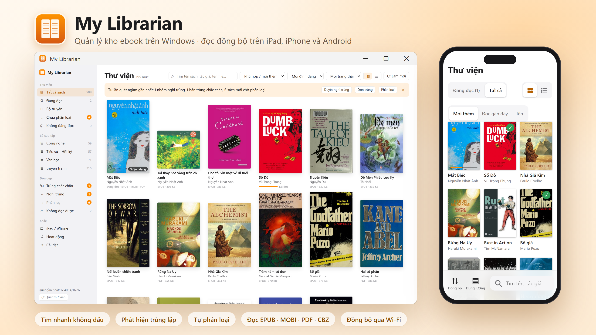

# My Librarian



Ứng dụng Windows quản lý kho ebook: quét, tìm nhanh không dấu, phát hiện trùng lặp an toàn, phân loại vào các thư mục thể loại có sẵn, quét ngầm hằng ngày. Yêu cầu: [docs/BRD.md](docs/BRD.md) · Backlog & tiến độ: [docs/BACKLOG.md](docs/BACKLOG.md).

Hiện có **lõi Rust (`crates/core`), CLI (`crates/scanner-cli`) và app Tauri 2 (`crates/app` + `ui/`)** với giao diện thư viện kiểu Apple Books (M1–M4) và **trình đọc trong app** (M5): EPUB, MOBI/AZW/AZW3, FB2, CBZ, CBR (zip và RAR), PDF, TXT. DJVU vẫn mở bằng ứng dụng mặc định của Windows. Bộ cài .msi / NSIS do `scripts\ci.ps1` tạo trong `dist\`; trước khi dùng trên kho thật hãy làm theo [docs/TRIAL.md](docs/TRIAL.md). Số đo hiệu năng: [docs/PERF.md](docs/PERF.md) (`librarian bench`). Chi tiết: [docs/BACKLOG.md](docs/BACKLOG.md#10-tiến-độ).

## Cấu trúc

```
crates/core/         thư viện lõi: scan, metadata, SQLite+FTS5, băm, dedupe, phân loại, di chuyển/hoàn tác, thùng rác
crates/scanner-cli/  librarian.exe (CLI) và librarian-bg.exe (tác vụ ngầm, không cửa sổ)
crates/app/          my-librarian.exe – app Tauri 2 (IPC + giao thức cover:// cho ảnh bìa)
crates/ipad/         app iPad + iPhone (Tauri 2, iOS) và điện thoại Android – đọc sách đồng bộ từ app Windows qua Wi-Fi
ui/                  giao diện HTML/CSS/JS thuần (không cần bước build); mock.js = backend giả để xem trên trình duyệt
ui/ipad/             giao diện thư viện iPad (dùng chung trình đọc trong ui/)
scripts/serve-ui.mjs xem trước giao diện trên trình duyệt với dữ liệu giả
docs/                BRD, backlog, BUILD.md (build lại Windows + iPad), IPAD.md (cài app iPad), IPHONE.md (cài app iPhone)
```

**Build bản cài mới sau khi sửa code:** Windows – bấm đúp `build-windows.cmd`; iPad – bấm đúp `build-ipad.command`, iPhone – `build-iphone.command`, Android – `build-android.command` trên Mac. Chỉ build khi code đổi, tự tăng phiên bản và chạy test. Chi tiết: [docs/BUILD.md](docs/BUILD.md).

Dữ liệu app nằm ở `%APPDATA%\my-librarian\` (`library.db`, `config.json`, `logs\`, `backups\`); đổi bằng `--home` hoặc biến `LIBRARIAN_HOME`. Ngoài các file sách bạn duyệt di chuyển/xoá, app không ghi gì vào ổ sách.

## Build

Cần Rust ≥ 1.89.

- **MSVC (khuyến nghị):** cài *Visual Studio 2022 Build Tools* với workload "Desktop development with C++", rồi:
  ```bash
  cargo test --workspace
  cargo build --release
  ```
- **GNU (không cần quyền admin):** cài MinGW-w64 (vd. `winget install BrechtSanders.WinLibs.POSIX.UCRT`), thêm thư mục `mingw64\bin` vào `PATH`, rồi:
  ```bash
  rustup toolchain install stable-x86_64-pc-windows-gnu
  cargo +stable-x86_64-pc-windows-gnu test --workspace
  ```

Test thật với Thùng rác Windows (xoá một file tạm rồi Restore) được đánh dấu `#[ignore]`:

```bash
cargo test -p librarian-core --test windows_recycle_bin -- --ignored
```

## CI tại máy

Không dùng dịch vụ ngoài; mọi thứ chạy trên máy Windows này (backlog D17, E0-02).

```bash
powershell -ExecutionPolicy Bypass -File scripts/ci.ps1
```

Chạy lần lượt: format → clippy (`-D warnings`) → test → build release → đóng gói .msi/NSIS (nếu đã cài `tauri-cli`). Bản build lưu ở `dist/<phiên bản>-<thời gian>-<commit>/` (giữ 10 bản gần nhất), log ở `target/ci/` (`latest.log` là lần gần nhất). Tự chọn toolchain MSVC nếu có Build Tools, ngược lại GNU. Tham số: `-Quick` (chỉ format + clippy + test), `-NoBundle`, `-Toolchain msvc|gnu`.

- **Chặn push khi hỏng:** `scripts/install-hooks.ps1` bật hook `.githooks/pre-push` (chạy `ci.ps1 -Quick`). Bỏ qua một lần: `git push --no-verify`.
- **Chạy mỗi đêm:** `scripts/register-nightly.ps1 [-At 02:00]` đăng ký Task Scheduler (chạy bù nếu máy tắt đúng giờ); gỡ bằng `-Remove`.
- **Đóng gói** cần `tauri-cli`: `cargo install tauri-cli --version "^2" --locked`.

## Gộp thư mục thể loại sau khi giải nén

`scripts/merge-categories.py` (Python 3, không cần thư viện ngoài) gộp các thư mục thể loại trùng/lồng nhau ở cấp 1 của kho: `Hồi Ký, Tuỳ Bút` + `Hồi Ký - Tùy Bút` → một thư mục; `Bút Ký - Hồi Ký - Thơ` khi đã có `Bút Ký - Hồi Ký` → hồi ký về thư mục có sẵn, phần còn lại thành `Thơ`. Mỗi tác phẩm (mọi định dạng cùng tên) được xếp theo tên sách, metadata EPUB/MOBI, từ khoá trong phần đầu sách và hình dạng dòng (thơ). Bỏ qua `Calibre Library` và hộp thư đến.

```bash
python -I scripts/merge-categories.py plan "D:\books"
python -I scripts/merge-categories.py apply "D:\books" merge-plan.csv
python -I scripts/merge-categories.py undo merge-undo-<thời gian>.jsonl
```

`plan` không đụng vào ổ sách, chỉ ghi `merge-plan.csv` (mở bằng Excel, sửa cột `den_thu_muc` hoặc xoá `x` để bỏ qua). Thêm `--also "D:\books\dtv books"` để gộp cả thư mục thể loại giải nén bên trong thư mục nguồn. Xong thì quét lại trong app.

## Chạy app

```bash
cargo run -p librarian-app
```

Lần đầu app hỏi thư mục `books` rồi tự quét. Bộ cài Windows: bấm đúp `build-windows.cmd`; app iPad: bấm đúp `build-ipad.command` trên Mac. Xem [docs/BUILD.md](docs/BUILD.md).

Xem trước giao diện không cần Rust (dữ liệu giả):

```bash
node scripts/serve-ui.mjs
```

Giao diện Windows ở http://localhost:5173/, giao diện iPad ở http://localhost:5173/ipad/index.html (thêm `?iphone=1` để xem bản iPhone, `?android=1` để xem bản Android).

## Dùng thử CLI

```bash
librarian gen-sample D:\thu-nghiem
librarian init D:\thu-nghiem\books
librarian scan
librarian search mat bi
librarian analyze
librarian dupes
librarian suspects
librarian classify
librarian evaluate
```

Lệnh thay đổi file chỉ **xem trước**; thêm `--yes` để thực hiện:

| Lệnh | Tác dụng |
|---|---|
| `dupes --yes [--keep HASH=ID]` | Dọn mọi bản trùng chắc chắn (SHA-256) vào Thùng rác |
| `trash <id...> --yes` | Xoá sách đã chọn vào Thùng rác |
| `classify --yes [--include-medium]` | Di chuyển sách từ `Chưa phân loại` vào thư mục đề xuất |
| `triage [--yes]` | Tự phân loại cả hộp thư đến (kể cả thư mục kiểu Calibre): đọc `metadata.opf`, làm phẳng, tạo thư mục thể loại mới, chưa chắc → `Khác`, rồi đưa mọi file không phải sách (kể cả âm thanh, video) và thư mục thừa vào Thùng rác. Mặc định chạy tự động mỗi lần quét; tắt bằng `config --auto-triage false` |
| `move <id> <thư mục> --yes` | Phân loại tay |
| `undo <lô>` | Hoàn tác một lô di chuyển |
| `decide <id...> --not-dup / --keep-both` | Duyệt nhóm nghi trùng (ghi nhớ kể cả sau khi quét lại) |
| `activity [lô]`, `report`, `series`, `categories`, `backup`, `config` | Xem nhật ký, báo cáo, cấu hình |

Thêm `--read-only` vào bất kỳ lệnh nào để chắc chắn không file nào bị thay đổi (dùng khi thử trên kho thật, E10-02). Thêm `--json` để lấy kết quả dạng JSON.

**Thử trên kho thật:** chạy `librarian config --read-only true` trước, rồi `scan`, `analyze`, `dupes`, `suspects`, `classify`, `evaluate` để đối chiếu kết quả. Chỉ tắt read-only khi kết quả đã ổn.

## Quét ngầm

`librarian-bg.exe [--home <dir>]` chạy quét + băm + tìm trùng + đề xuất phân loại, chỉ ghi DB/log, rồi thoát (mã 0 = xong, 2 = app đang quét, 1 = lỗi). Việc đăng ký lịch trong Task Scheduler (E8-02) chưa làm. Tạm thời có thể đăng ký tay:

```bash
schtasks /Create /SC DAILY /ST 03:00 /TN "My Librarian scan" /TR "\"C:\path\librarian-bg.exe\""
```

## Giấy phép

[MIT](LICENSE). Thư viện kèm theo trong `ui/vendor/foliate-js` giữ giấy phép riêng: foliate-js (MIT), pdf.js (Apache-2.0).
